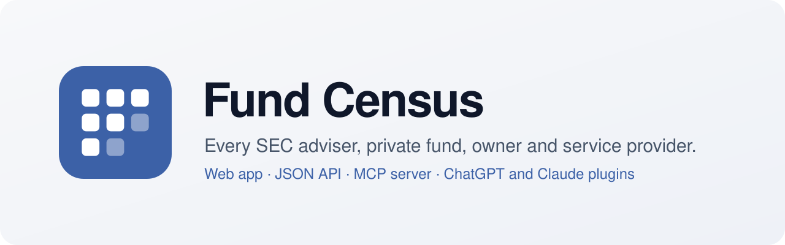
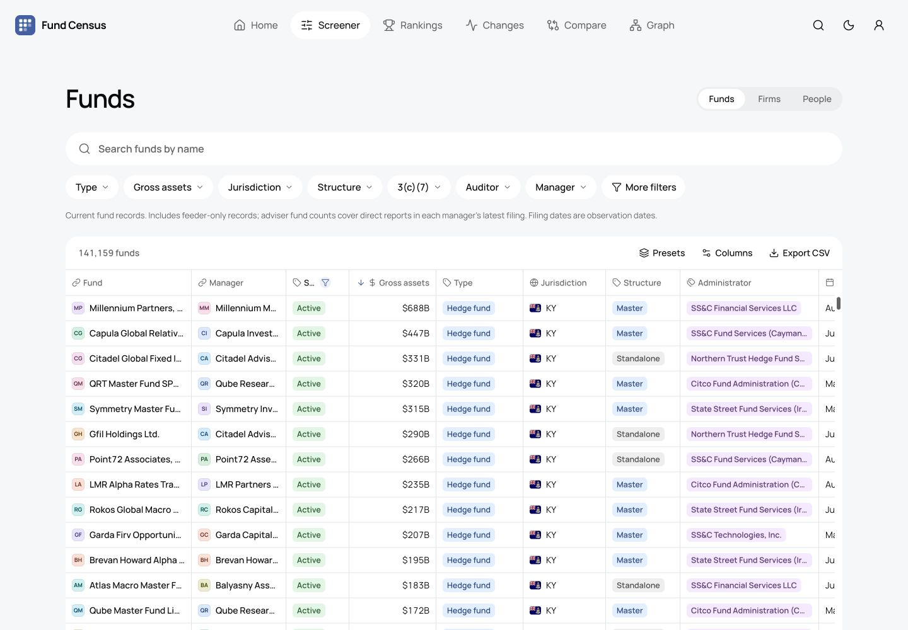
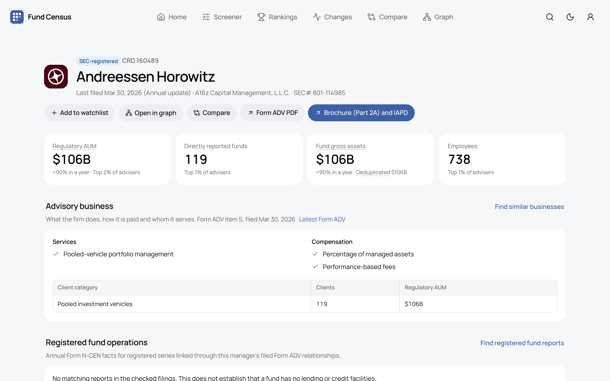
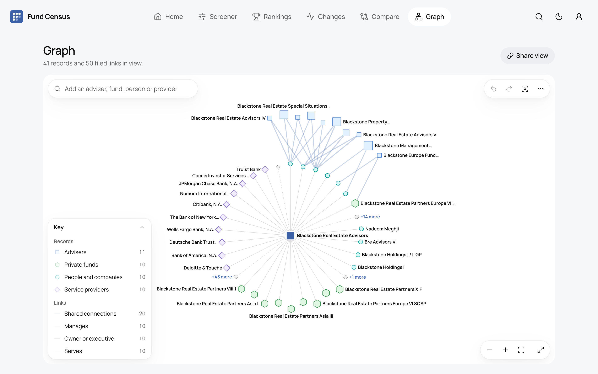
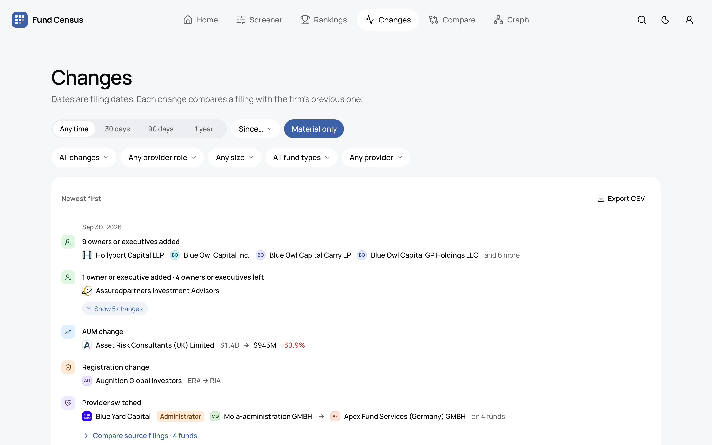
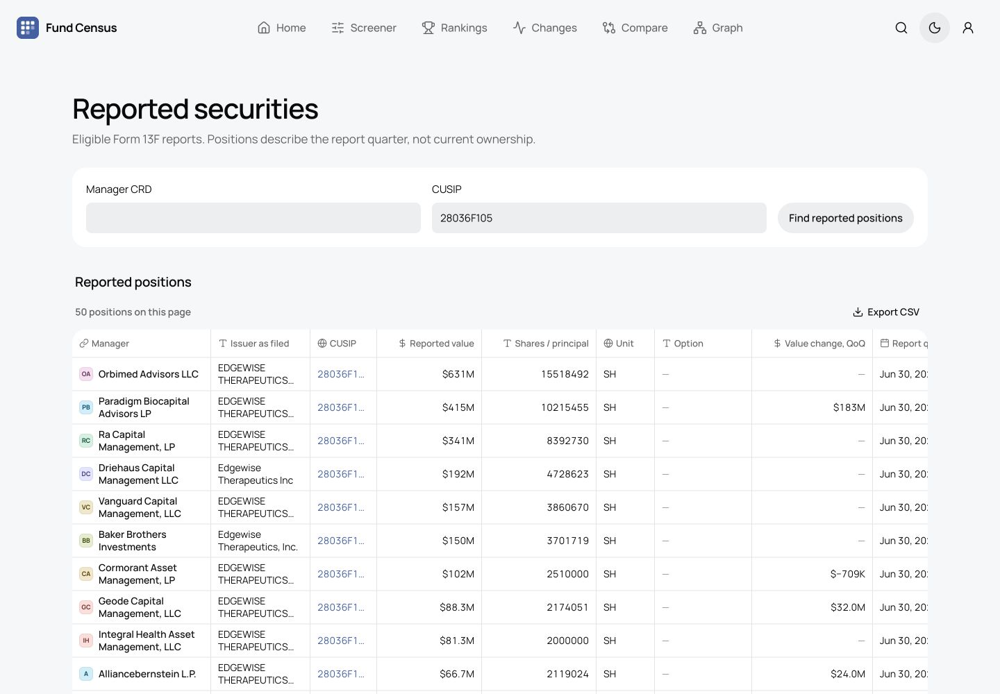

<p align="center">
  
</p>

<p align="center">
  Every SEC-registered adviser, private fund, owner and service provider, with their fundraising, holdings and stakes.<br>
  Search it on the web, or ask about it in Claude and ChatGPT.
</p>

<p align="center">
  <a href="https://fundcensus.com"></a>
  <a href="https://fundcensus.com/account"></a>
  <a href="https://fundcensus.com/openapi.json"></a>
  <a href="#data"></a>
</p>



## Use it

**On the web.** [fundcensus.com](https://fundcensus.com) is free and needs no account.

**In Claude or ChatGPT.** Add a custom connector with `https://fundcensus.com/mcp` and sign in. It's free, with 25 lookups a day. [Setup steps](https://fundcensus.com/docs#connect).

**In Claude Code.**

```text
/plugin marketplace add kaanarici/fundcensus
/plugin install fund-census@fund-census
```

**From your code.** Create a key at [fundcensus.com/account](https://fundcensus.com/account) and read the [API docs](https://fundcensus.com/docs#api).

**From an AI agent.** Start at [fundcensus.com/llms.txt](https://fundcensus.com/llms.txt). The home page, docs and every profile answer `Accept: text/markdown`, and agents can register themselves through [auth.md](https://fundcensus.com/auth.md).

Try asking:

- "Who audits and custodies Andreessen Horowitz's funds?"
- "Hedge funds over $1B that switched auditors in the last year"
- "Which firms are connected to Blackstone through shared owners?"
- "Which securities do two managers both report on their latest Form 13F?"

<table>
  <tr>
    <td></td>
    <td></td>
  </tr>
  <tr>
    <td></td>
    <td></td>
  </tr>
</table>

## Data

Fund Census reads every Form ADV filed since 2011: about 25,000 active advisers, 141,000 private funds, 109,000 owners and executives, and 15,000 auditors, administrators, custodians, prime brokers and marketers. It adds Form D fundraising, Form 13F holdings, Schedule 13D/13G stakes, Forms 4/5 insider transactions, and Form N-CEN and N-PORT registered fund operations and holdings, and links filings to each other only by exact identifiers. Profiles link back to the filings they come from.

It is not affiliated with the SEC and is not investment advice. Found a mistake? [Open an issue](https://github.com/kaanarici/fundcensus/issues). [Docs](https://fundcensus.com/docs) · [Privacy](https://fundcensus.com/privacy) · [Terms](https://fundcensus.com/terms) · support@fundcensus.com

The Claude Code plugin in `plugins/` is MIT licensed.
